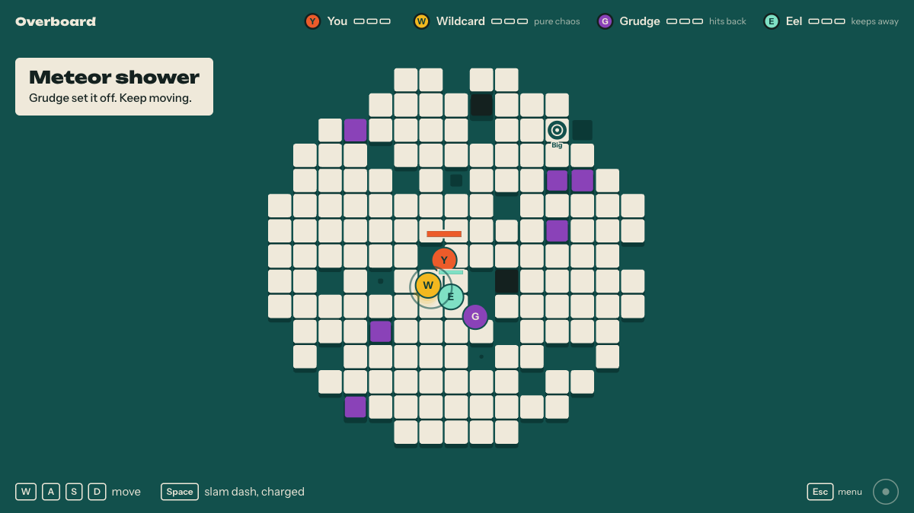

# Overboard

Bumper sumo on a raft. Knock everyone else into the water. If you fall in, you can still pull planks, tip the raft and send waves at whoever remains.

**[Play Overboard](https://overboard-game.vercel.app/)** on a computer or phone.



## Play

Four players share the raft; bots fill empty seats. First to win three rounds wins the match.

- **Play online:** Join a public room. If you are alone, you can start against bots.
- **Create room:** Share an invite link or five-character code with friends.
- **Play solo (unranked):** Play against three bots in your browser.

| | Controls |
|---|---|
| On the raft | `W` `A` `S` `D` to move; `Space` to dash |
| In the water | Click a plank to pull it; `W` `A` `S` `D` to tip; `Space` to send a wave toward the cursor |
| Any time | `Esc` to pause; `M` to mute |

On touch screens, drag on the left to move or tip, tap a plank to pull it, and use the button on the right to dash or send a wave. The game explains pickups and other rules as they appear.

## Run locally

Open `index.html` in a browser for solo play. For rooms, run `npm ci` and `npm run dev` in `server/`, then serve the repository root over HTTP. There is no frontend build step.

Run the gameplay and server checks with:

```sh
node test/sim.test.js
node server/test.mjs
node server/quick.test.mjs
```

The browser game lives in `js/`. The Cloudflare Worker in `server/` runs multiplayer rooms, shared statistics and the weekly leaderboard. `server/build-site.mjs` selects the files deployed to Vercel. See [AGENTS.md](AGENTS.md) for contributor guidance.
